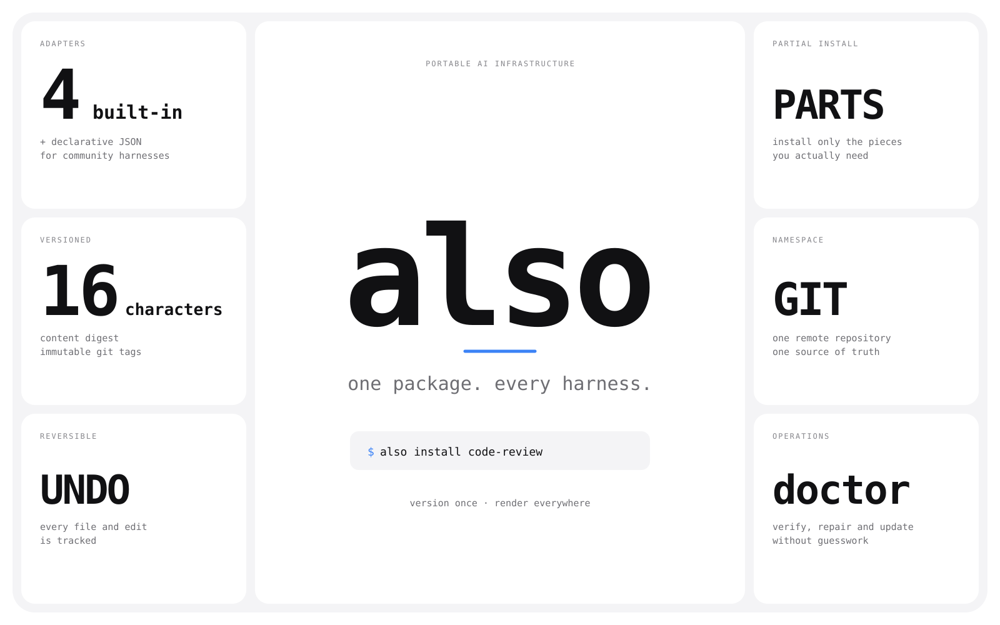

<p align="center">
  
</p>

<p align="center">
  <strong>Version once. Run anywhere.</strong>
</p>

`also` is a command-line interface for versioning and sharing artificial intelligence infrastructure. Instructions, skills, commands, agents, hooks, Model Context Protocol servers and settings live in one portable package, and an adapter renders that package into the native layout of every harness.

## 1. The Problem

Every harness invented its own layout for the same ideas. One expects `CLAUDE.md`, another reads `AGENTS.md`, a third uses `QWEN.md`, and each keeps skills, commands, agents, hooks, Model Context Protocol servers and permission settings in a different place. The names, file formats and merge rules rarely match.

The usual result is duplication. The same review skill is copied into four projects. A useful hook exists only in the harness where it was written. A permission change is made in one configuration file and forgotten in the other three. Nothing has a meaningful version, so rolling back means remembering which copy was good.

`also` removes that duplication:

- one portable package describes the infrastructure once;
- adapters translate it into each harness layout;
- every package version is content-addressed and stored in git;
- installation is reversible, including instructions blocks and configuration edits;
- the same package can live in several harnesses inside one directory.

## 2. Quick Start

Run one command:

```sh
curl -fsSL https://raw.githubusercontent.com/seinsdieum/also/main/install.sh | sh
```

The installer detects the operating system and architecture, downloads the latest release from GitHub, verifies its SHA-256 checksum, installs the binary into `~/.local/bin`, and immediately launches the interactive setup. Setup detects installed harness command-line interfaces, asks for a default harness, connects one or more remote namespaces, and optionally installs a starter package.

On Windows, use PowerShell:

```powershell
powershell -ExecutionPolicy Bypass -c "irm https://raw.githubusercontent.com/seinsdieum/also/main/install.ps1 | iex"
```

For unattended machines, set `ALSO_NO_SETUP=1` and provide setup flags:

```sh
curl -fsSL https://raw.githubusercontent.com/seinsdieum/also/main/install.sh | ALSO_NO_SETUP=1 sh
also setup --yes --harness opencode \
  --namespace personal=git@github.com:you/ai-infrastructure.git \
  --default-namespace personal
```

You can also install with Go:

```sh
go install github.com/seinsdieum/also@latest
also setup
```

Initialize the directory that holds your infrastructure:

```sh
cd my-infrastructure
also init code-review for claude
also push
```

`also init` writes `also.json` with the package name and source harness. From then on `also push` publishes that directory and needs no path, no name and no harness. A directory without `also.json` is refused, so you cannot publish an unrelated working directory by accident.

Install the package into another directory:

```sh
cd ../my-project
also install code-review for opencode
also install code-review for claude from personal
```

Capture infrastructure that already exists in a harness layout:

```sh
cd ../existing-project
also init existing-rules for claude
also adopt for claude
```

Keep the package and the tool current from the directory where it is installed:

```sh
cd ../my-project
also upgrade
also update
```

`also upgrade` upgrades the packages installed in the current directory. `also update` checks the latest GitHub release, verifies the published checksum and replaces the current binary. If a newer release exists, ordinary commands occasionally print a single notice with the next step.

## 3. What also Does

### Initialization

`also init <name> [for <harness>]` writes `also.json` into the current directory. The file records the package name and the source harness, and it is never published inside the package. Every command that publishes, captures or upgrades infrastructure uses that marker, so the working directory is the only argument you need:

```sh
also init code-review for claude
also push
also adopt for claude
also upgrade
```

If the harness is omitted, `also init` uses the layout already present in the directory and then the configured default harness.

### Namespaces

A namespace is a remote git repository that stores packages. It is only a name and a remote uniform resource locator; the local clone is an internal cache. Connect one during setup or add it later:

```sh
also connect personal git@github.com:you/ai-infrastructure.git
also use personal
```

Choose a namespace per operation with `from <namespace>`:

```sh
also install code-review for opencode from personal
also show code-review from personal
```

### Versions

A package is a directory tree inside a namespace with one live version and immutable version tags. The version identifier is the first sixteen hexadecimal characters of a content digest, so identical content always produces the same version and different content can never reuse an old one. Pin a version with `package@version` when a moving latest version is not appropriate.

### Adapters and cross-harness architecture

An adapter describes where a harness keeps each component and how it encodes configuration. A built-in adapter is ready to install without compiling code. A community adapter is declarative JSON and reuses an existing encoding.

| Adapter | Instructions | Skills | Commands and agents | Hooks and settings | Model Context Protocol |
|---|---|---|---|---|---|
| Claude Code | `CLAUDE.md` | `.claude/skills` | yes | yes | yes |
| Codex CLI | `AGENTS.md` | `.agents/skills` | not supported by the harness | project layers require a trusted project | yes |
| OpenCode | `AGENTS.md` | `.opencode/skills` | yes | yes | yes |
| Qwen Code | `QWEN.md` | `.qwen/skills` | yes | yes | yes |

Cross-harness translation is deliberately honest. A component that has no equivalent in the target harness is skipped with a warning instead of being written into a file the harness ignores. Native data that cannot be translated is preserved in `.also-layers/` so a later round trip can restore it.

Add a community adapter without recompiling:

```sh
also add harness ./harness.json
also add harness https://example.com/harness.json --sha256 <digest>
```

Adapters are declarative. They cannot execute code, user-wide paths must stay below the home directory, and downloaded specifications can be pinned to an exact checksum.

### Installation and removal

`also` remembers every created file, managed instructions block and configuration edit in `~/.also/state.json`. Uninstalling removes only what the package still owns. If you edited a file, `also` refuses to delete it unless you pass `--force`, and it keeps a backup before overwriting anything.

Install only the parts you want:

```sh
also install review skill from code-review for opencode
also install mcp from code-review
```

Supported selectors include `instructions`, `skills`, `commands`, `agents`, `plugins`, `hooks`, `mcp`, `settings` and adapter-defined component kinds.

### Main commands

| Command | Purpose |
|---|---|
| `also setup` | Interactive first-run setup with harness and namespace choices. |
| `also init <name> [for <harness>]` | Mark the current directory as portable infrastructure. |
| `also connect <name> <git-url>` | Connect a remote namespace. |
| `also use <namespace>` | Choose the active namespace. |
| `also list` | List packages and versions in a namespace. |
| `also show <package>[@version] [from <namespace>]` | Show a package manifest and its components. |
| `also install <package> [for <harness>] [from <namespace>]` | Install a package into the current directory. |
| `also adopt [directory] [for <harness>]` | Capture the initialized infrastructure and publish a new version. |
| `also push [directory]` | Publish the initialized directory; no path is needed. |
| `also upgrade` | Upgrade the packages installed in the current directory. |
| `also reshape <harness>` | Re-materialize installed packages for another harness. |
| `also tree` | Show only the installed infrastructure. |
| `also uninstall <package>` | Remove an installation and reverse its configuration edits. |
| `also doctor` | Check git, configuration, adapters, caches and installs. |
| `also verify` | Verify package digests, version tags and installation state. |
| `also repair <namespace>` | Re-clone a broken internal namespace cache. |
| `also update` | Update the binary to the latest published release. |

The complete command reference, JSON output shapes and exit codes live in [docs/CLI.md](docs/CLI.md).

### Update notices

On a successful command, `also` consults the latest GitHub release at most once per day. It caches the answer in `~/.also/update-check.json` and prints a short “New version available” line at most once per interval, on standard error, so machine-readable output stays clean. Set `ALSO_NO_UPDATE_CHECK=1` to disable the lookup.

## 4. Contributing

Contributions are welcome. The project is written in Go and targets Go 1.23 or newer.

```sh
git clone https://github.com/seinsdieum/also.git
cd also
make check          # formatting, vet and tests
make build          # build bin/also
make smoke          # exercise the real harness command-line interfaces, if installed
```

`make check` runs `gofmt`, `go vet` and the full test suite with the race detector in continuous integration. The four-by-four harness matrix in `test/e2e/matrix_test.go` runs on every platform. The `make smoke` target is optional locally because it needs the real harness binaries; it never calls a model.

Useful documents:

- [docs/ARCHITECTURE.md](docs/ARCHITECTURE.md) for the package, adapter and rendering model;
- [docs/ADAPTERS.md](docs/ADAPTERS.md) for adding a harness without recompiling;
- [docs/PACKAGE_FORMAT.md](docs/PACKAGE_FORMAT.md) for the package contract;
- [docs/CONTRACTS.md](docs/CONTRACTS.md) for schema stability and migration policy;
- [docs/CLI.md](docs/CLI.md) for the command reference.

Before opening a pull request, run `make check`, keep user-facing text in complete English sentences, and add a test for any new branch, parser, security check or installer path. Adapter changes must keep the declarative path bounds and must not execute code. Security issues should go through the private channel described in [SECURITY.md](SECURITY.md), not through a public issue.

See [CONTRIBUTING.md](CONTRIBUTING.md) for the full workflow.

## 5. Credits

`also` is built with the Go programming language, the Cobra command-line framework, the BurntSushi TOML library and the `yaml.v3` library. It exists because Claude Code, Codex CLI, OpenCode and Qwen Code each publish a thoughtful but different configuration model.

Thank you to every contributor and to the maintainers of those projects and libraries.

## 6. License

`also` is released under the [Apache License 2.0](LICENSE). You may use it in personal and commercial products.

Copyright 2026 Aliaksandr Sialitski. The license keeps authorship with the project and requires that redistributions preserve the copyright notice and the [NOTICE](NOTICE) file. If you embed `also` inside another product, credit the project in that product's credits or documentation. The NOTICE file records the exact attribution text.

Third-party dependencies remain under their own licenses.
